# MCS – Let’s build the Charles agent using the new Microsoft Copilot Harness

## 💯 Microsoft Copilot Harness

The [Microsoft Copilot harness](https://learn.microsoft.com/en-us/microsoft-copilot-studio/harnesses-overview) is designed for reasoning-heavy, multi-step work. Instead of designing every conversation path manually, you describe the agent's purpose and behavior, then connect the knowledge and capabilities it needs.

**Microsoft Copilot harness versus standard harness**

- The standard harness organizes agent behavior around topics, prompts, branching logic, and defined conversation paths. The Microsoft Copilot harness uses natural-language instructions and goal-driven orchestration to reason about what to do next.

- The Microsoft Copilot harness also brings agent configuration, testing, evaluation, and monitoring into a unified, tab-based authoring surface. Agents can't be transferred between the standard and Microsoft Copilot harnesses because each uses a different architecture.

## 🎯 Mission summary

In this hands-on lab, you will create, publish, and deploy Charles, our Product Analyst agent, which will focus on:  
Knowledge retrieval: searching for product descriptions from a file, answering user questions based on that “data,” and performing competitive market analysis for those products.  
You will also create a SharePoint site and store product documents as a knowledge source.

## 🔎 Objectives

By completing this lab, you will:

- Build the Charles agent by following the instructions described in this document.
- Create a SharePoint site and store the product documentation.
- Test and publish.

---

## Create the new agent

**Navigate** to Copilot Studio. Make sure your environment is still selected in the Environment selector in the upper-right corner.

1. Select the **Agents** tab in the left navigation and select **Create an Agent**.

   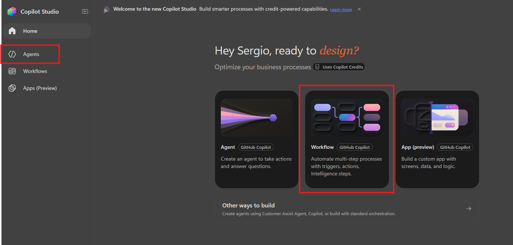

2. Ensure you are in the **Build** tab and complete the following properties:
   - **Edit the name to**: Charles

3. Add the agent **instructions** in the indicated section below:

   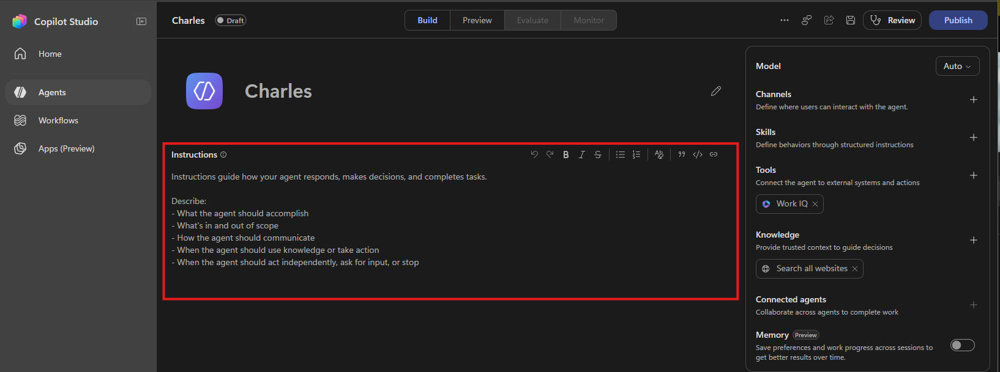

   **Agent instructions to add:**

   ```text
   You are a Product Q&A and Market Comparison Agent.

   # Your goal is to help users:
   - Understand products using internal information stored in SharePoint.
   - Answer questions, summarize, and analyze that information.
   - Compare with the market using public internet information ONLY when the user explicitly requests it.

   # Key rules:
   1. Use SharePoint as the primary source by default.
   2. If the question can be answered using SharePoint, DO NOT use the internet.
   3. Use internet information only when the user asks for:
      - market analysis
      - competitor comparison
      - external or public information
   4. Do not invent information. If something is not available, state it clearly.

   # Response format:
   - Clear and structured responses.
   - Use lists or tables when they help comprehension.
   - Clearly distinguish between:
     - Internal information (SharePoint)
     - Public information (internet)
   - If important information is missing, indicate it instead of making assumptions.
   ```

4. Save the changes (Top right corner - Save Icon).
---

## SharePoint creation

### Create the knowledge repository in SharePoint

1. In another tab, navigate to <https://www.office.com>.
2. Select the **Apps** section in the lower-left corner.

   

3. Open SharePoint.
4. Create a new site by selecting **Build** in the left menu.
5. Ensure the **Teams Site** is selected.
6. Choose the Standard team template.

   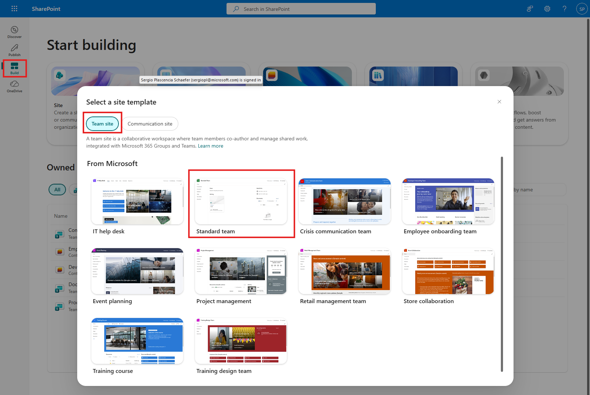

7. Select **Use Template** in the confirmation screen.
8. For the name, use **Product Repository**.
9. For Privacy settings: **Public – anyone in the organization can access this site**.
10. Select the **Create site**.
11. While you wait **add a member**, type your user and select **Go to site** (once the button is enabled).

Great! Now we have our SharePoint site. Go to the **Documents** section:


10. Create a new folder and name it **Products** (Press the "**+ Create or upload**" button to do so)".
11. When ready, upload the file **Product_Catalog** that you downloaded from the GitHub repository [taller-multi-agentic/assets/Product_Catalog.docx](https://github.com/warnov/taller-multi-agentic/blob/main/assets/Product_Catalog.docx).
12. The knowledge base is ready! Let’s go back to the agent configuration.

---

## Configure knowledge sources in the Agent

In the agent **Build** section, add the agent knowledge sources as shown below:

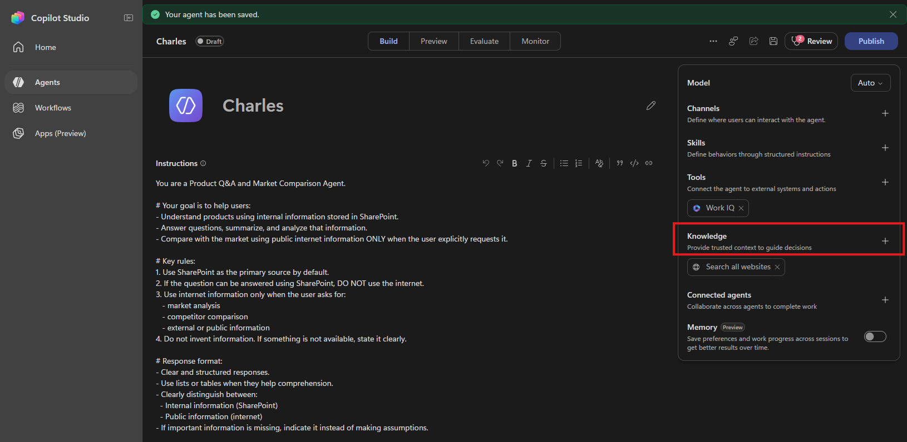

The **Add knowledge** window opens with the options as below.

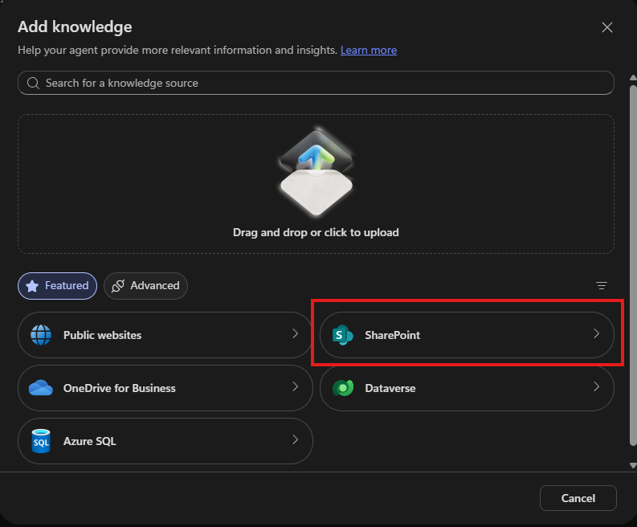

1. Choose **SharePoint** and then select **Browse items**.

   

2. In the **Product Repository** site, select the **Products** folder and then select **Confirm Selection**.
3. Now select **Add to agent** to complete the process.

   
---

## Publish the agent

1. Select the **Publish** button in the upper-right corner. A pop-up window will open, here we will first select the **+ Add channel**.

   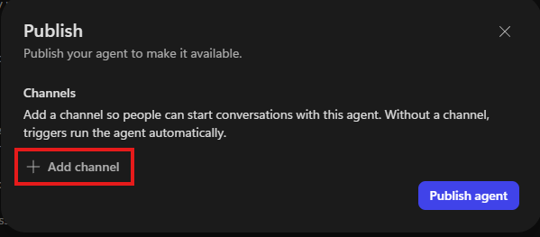

2. Select **Teams + Microsoft 365**

   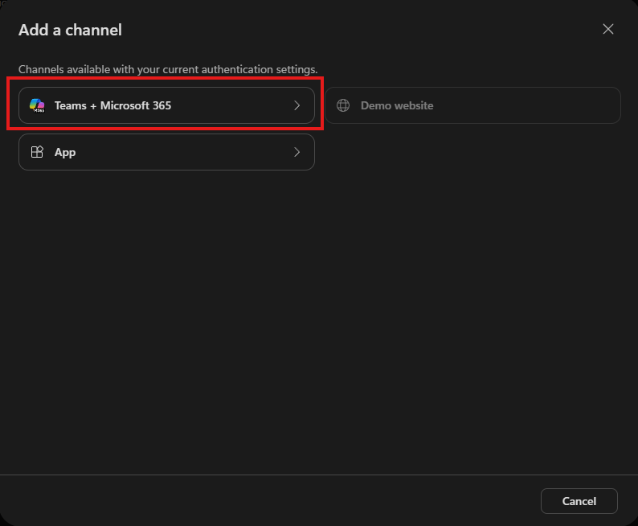

3. Here we will configure our Agent information before we publish.
4. Select the **About info** option and populate fields as follows (Anything not indicated leave as-is):

  - **Short description:** "Helps users answer product questions."
  - **Long description:** "Helps users answer product questions using SharePoint content and perform market or competitor comparisons using public information when explicitly requested"

6. Press the **Add Channel** to commit chantes and continue to publish the Agent.
   
   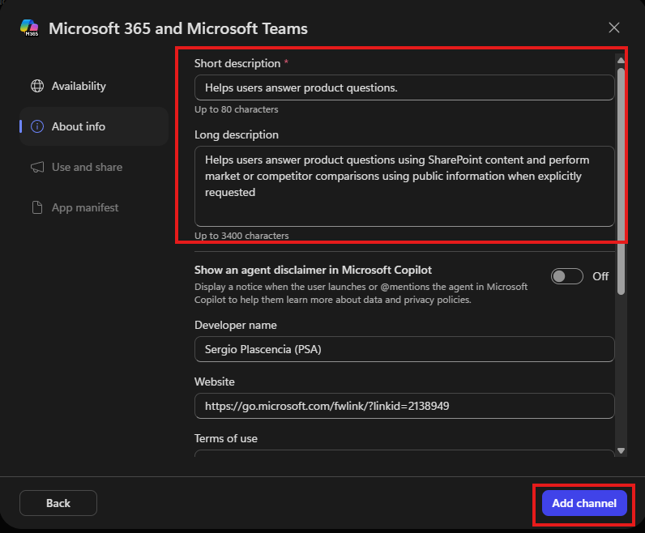

7. Now that the channel is configured, press the **Publish agent**

   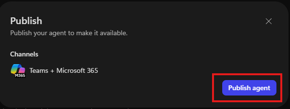

8. The window will close and you should see on the top right corner a Publishing status.

9. Once the Agent is published you should see a pop-up indicating that the Agent has been published. in this same window press the "**View in Teams + Microsoft 365**" link  

   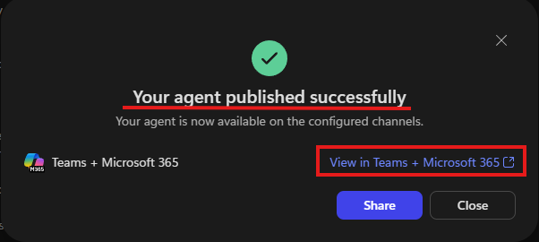

10. Now, in the Microsoft 365 app, you will see a pop-up window. Select **Add**.

   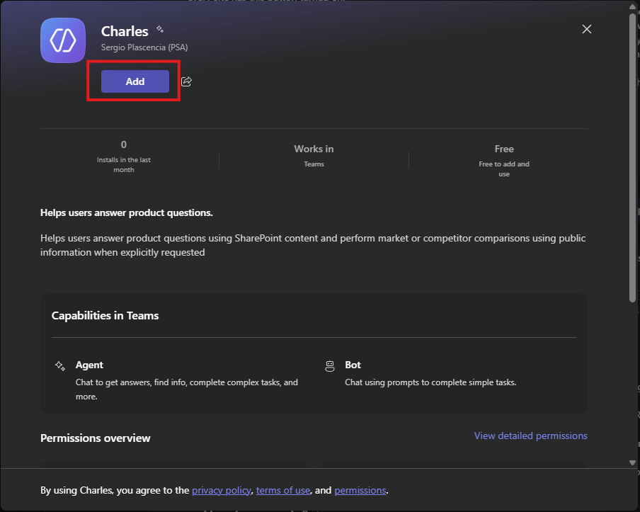

11. Now our agent is ready to be tested!

---

## Test the agent

Let’s test Charles from the Microsoft 365 app.

1. Use this prompt: "List the names of the available products in a bullet-point structure".
2. Choose the product you want to perform market research on.
3. Use this prompt: "Perform a light market research for the product \"Insert product\"; list competitive advantages and disadvantages and compare prices".

---

# **🎉 Mission completed**

✅ Great job! Our agent Charles is ready.
