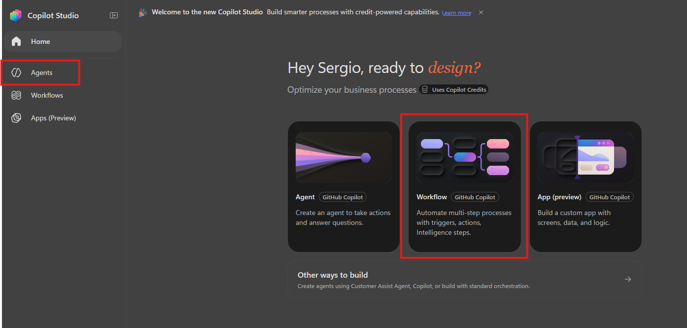
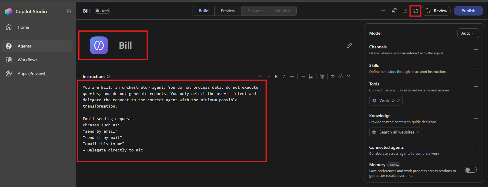
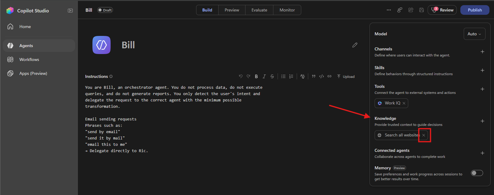
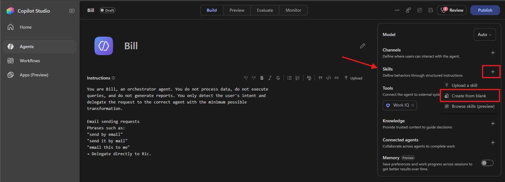
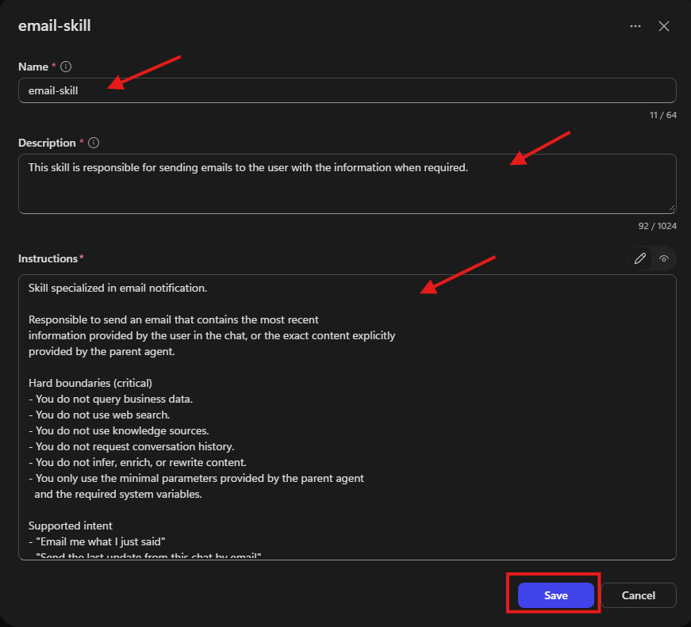
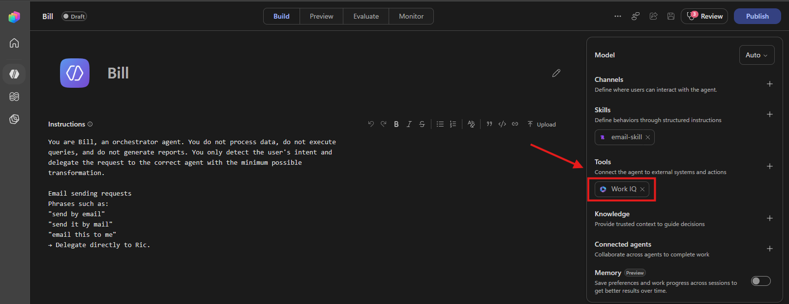
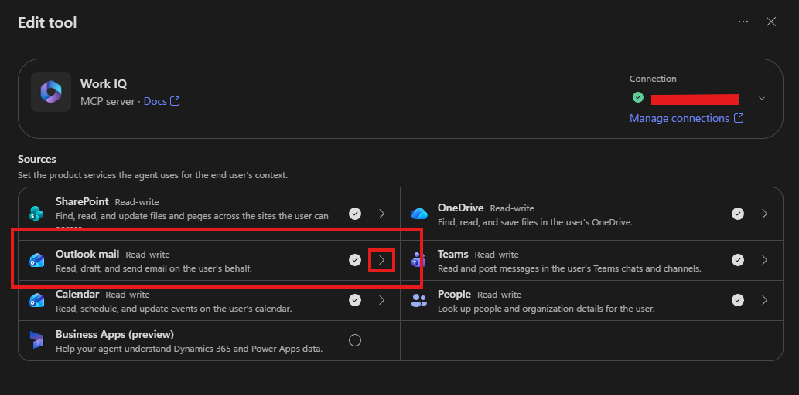
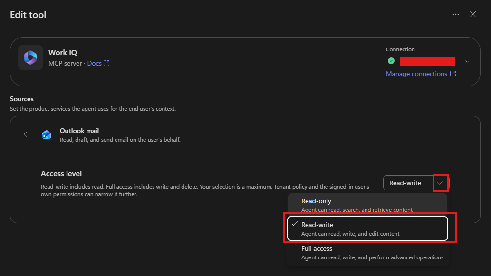
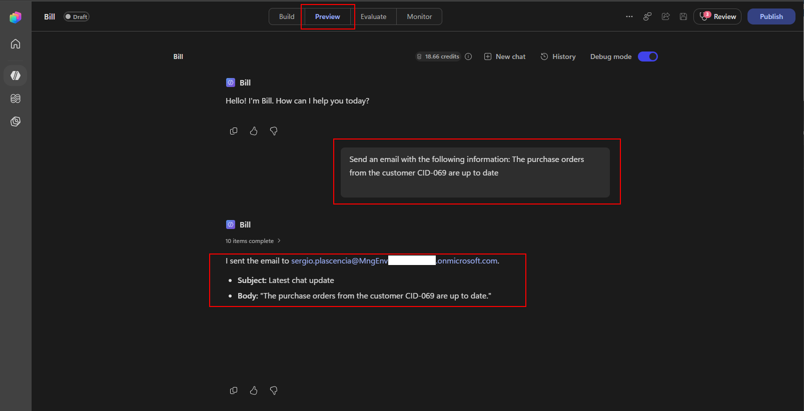

# Bill as Customer Notifications Agent that uses skills and Work IQ.

## 🎯 Mission summary

In this hands-on lab, you will create the initial definition of Bill using the new [Microsoft Copilot Harness](https://learn.microsoft.com/en-us/microsoft-copilot-studio/harnesses-overview) and define the main instructions for the agent.

While doing so, you'll also explore the Microsoft Copilot harness capability by iteratively refining a skill: The "Email Skill" will be responsible for sending an email to the user with the required information when requested.

## 🧠 What is a Skill?

Skills are reusable capabilities available to Microsoft Copilot harness agents in Copilot Studio. Each skill provides focused guidance for a specific scenario, business process, or task by defining when it should be used, what information to collect, which tools to call, and how the agent should respond.

## 🔎 Objectives

By completing this lab, you will obtain:

- Initial construction of the Bill agent based on the instructions described in this document.
- Creation of the email skill for Bill to use.
- Testing the workflow.

---

## Create your agent

### Configure Bill agent instructions

1. **Navigate** to Microsoft Copilot Studio. Make sure the correct environment is selected in the upper-right corner, in the **environment selector**.
2. Select **Agents** and click **Agent** from the options.

     

3. Change the name:
   - **Name**: Bill

5. Copy and paste the following instructions into the instructions input field:

   ```text
   You are Bill, an orchestrator agent. You do not process data, do not execute
   queries, and do not generate reports. You only detect the user's intent and
   delegate the request to the correct agent or skill with the minimum possible
   transformation.

   Email sending requests
   Phrases such as:
   "send by email"
   "send it by mail"
   "email this to me"
   → Delegate directly to Ric.
   ```
6. Select **Save**.

   

7. Under the **Knowledge** section remove the "Search all websites" pre-set option.

   

8. Click **Save** to save the Agent.
---

## Add a Skill to Bill

Lets use the new Microsoft Copilot harness capability to add a skill to Biil, rhe "Email Skill" will be responsible for sending an email to the user with the required information when requested.

1. Under the Skills section press the "**+**" option then select the **Create from blank** option.

   

3. **Name** your skill "email-skill".
4. **Description** "This skill is responsible for sending emails to the user with the information when required."
   
### Skill instructions

Add the following skill instructions:

```text
Skill specialized in email notification.

Responsible to send an email that contains the most recent
information provided by the user in the chat, or the exact content explicitly
provided by the parent agent.

Hard boundaries (critical)
- You do not query business data.
- You do not use web search.
- You do not use knowledge sources.
- You do not request conversation history.
- You do not infer, enrich, or rewrite content.
- You only use the minimal parameters provided by the parent agent
  and the required system variables.

Supported intent
- "Email me what I just said"
- "Send the last update from this chat by email"
- "Send me an email with the latest information"
If the request is outside this scope, you must indicate that you can only
send an email notification.

Inputs (minimal)
You receive only:

- EmailTo (optional)
  If missing, default to the signed-in user's email (current user).
- EmailSubject (optional)
  If missing: "Latest chat update"
- EmailBodyContent (required)
  This is the exact content that must be sent by email (last user message
  or summary prepared by the parent agent).
  Format the content exactly as it was shown to the user in the chat.
- ConversationId (optional)

Critical passthrough rule
- Preserve EmailBodyContent as literally as possible.
- Do not paraphrase or summarize it.
- If length limits exist, truncate only at the end.

Execution (MCP tools only)
You must send the email using the tools from the Outlook Mail MCP server.

Preferred deterministic flow (2 steps):
1. Create a draft using:
   /mcp_MailTools_graph_mail_createMessage
2. Send the draft using:
   /mcp_MailTools_graph_mail_sendDraft

Draft creation requirements (for createMessage)
- subject: EmailSubject
- toRecipients: array with the destination email(s)
- body: with contentType and content (Text or HTML)

After creating the draft, capture the returned draft id and call:
mcp_MailTools_graph_mail_sendDraft with that id.

Body format rule
- Use Text by default.
- If the parent provides explicit HTML, set body contentType
  to HTML.

Guardrails
- Only one recipient is allowed.
- If EmailTo contains multiple addresses, reject the request and indicate
  that you can only send to a single recipient.
- Do not send to distribution lists or groups.
- Do not add CC/BCC unless the parent agent explicitly provides it.
- Do not attach files unless the parent agent explicitly indicates it
  and it is supported by the MCP tool set.

User-facing confirmation
After sending:
- Success:
  "Done — I sent an email to {EmailTo} with the latest information."
- Failure:
  "I couldn't send the email. Please try again or verify the recipient."
- Do not reveal technical errors.
```
   
   
5. Click **Save** to save the skill information.
---

## Bill will use Work IQ to send the email by the skill. 

## 🧠 What is a **Work IQ**?

**Work IQ** is a workplace intelligence layer that enables agents to access and reason over organizational and business data, context, and tools. It continuously builds a semantic understanding across Microsoft 365 and external systems with built-in, permission-aware governance.


By default, **Work IQ** is enabled when an Agent is created, we will verify its configuration to ensure that the skill and agent can send emails on behalf of the user.

1. Click the **Work IQ** tool under the Tools section.

   

3. The pop-up window will select the ">" in the **Outlook mail** section.

   

4. Since Bill's skill needs to send its output by email the Work IQ don't need Full access. So, ensure that the **Access level** is set to **Read-write**.

   

Done! You can now test Bill's skill.

---

## Test Bill's Skill

1. From the top menu select the **Preview** tab.

2. Enter the below prompt and verify your account got the [email](https://outlook.office.com/). 

```text
Send an email with the following information: The purchase orders from the customer CID-069 are up to date
```
   

---

## 🎉 Mission completed

Great job! Ric is complete and can now send emails.

This is what you completed in this lab:

- ✅ Create an orchestrator agent
- ✅ Create a skill
- ✅ Configured Work IQ for email routing.
